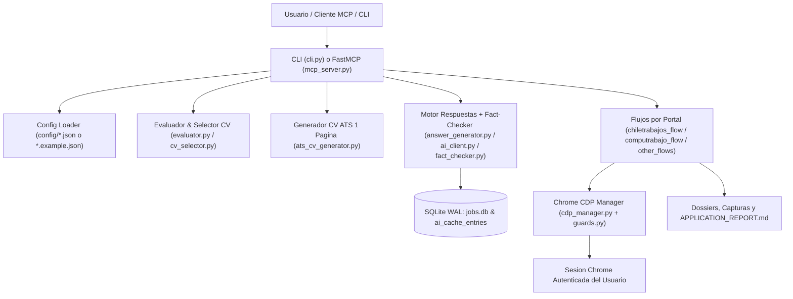

# Job Automator (`job-automator`)

Motor persistente, generador de CVs ATS de 1 página y servidor **MCP (Model Context Protocol)** en Python para asistir postulaciones laborales con supervisión humana (*Human-in-the-Loop*), validación determinista contra alucinaciones y trazabilidad completa en SQLite.

---

## Propuesta de Valor

- **Supervisión Humana (*Human-in-the-Loop*):** pre-rellena formularios, adjunta el CV óptimo y redacta respuestas para que el candidato revise y autorice cada envío antes de confirmarse.
- **Fact-Checker Determinista:** valida todo texto y currículum generado contra `config/candidate_profile.json` mediante `validate_text_truthfulness()`, bloqueando años inflados, certificaciones inexistentes o licencias falsas.
- **Generador ATS de 1 Página:** compila un PDF vectorial lineal con Playwright Chromium (`ats_cv_generator.py`), puntuando afinidad de palabras clave y priorizando proyectos/competencias reales del perfil.
- **Cero Falsos Positivos:** nunca marca una oferta como `CONFIRMED` sin verificación positiva explícita en el DOM (`verify_post_submit_confirmation()`), ausencia de errores/login y captura de respaldo.
- **Servidor MCP + CLI Portable:** operable desde clientes MCP (Antigravity, Claude Desktop, Cursor) o directamente por línea de comandos (`job-automator`).

---

## Arquitectura del Sistema



---

## Pilares de Seguridad y Confiabilidad

1. **Prohibición absoluta de `taskkill`:** el motor jamás cierra ni mata procesos del navegador del usuario; opera conectándose vía Chrome DevTools Protocol (`CDP`) a una instancia abierta por el usuario.
2. **Pre-Flight Check obligatorio:** comprueba que la sesión del portal en Chrome esté autenticada antes de interactuar con formularios (`run_preflight_check_on_page()`).
3. **Respeto a controles anti-bot:** nunca intenta resolver ni evadir CAPTCHAs o bloqueos de verificación; clasifica esas ofertas como `NEEDS_HUMAN_REVIEW`.
4. **Cero alucinación:** toda respuesta (determinista, en caché `SHA-256` o generada vía API de Gemini) pasa por `validate_text_truthfulness()`.
5. **Logs sanitizados:** `logging_utils.py` redacta automáticamente contraseñas, cookies, tokens y rutas WebSocket CDP en `data/logs/*.jsonl`.

---

## Estructura del Proyecto

```text
job-automator-oss/
├── .agents/skills/               # Skills reutilizables (/siguiente, /aprobar, /descartar, /resumen)
├── .github/workflows/ci.yml      # Pipeline GitHub Actions (Python 3.11 - 3.13 + Playwright + pytest)
├── config/
│   ├── candidate_profile.example.json
│   ├── cv_catalog.example.json
│   └── search_preferences.example.json
├── cvs/                          # Carpeta local para tus CVs base (.pdf / .docx)
├── scripts/
│   ├── init_workspace.py         # Inicialización rápida de carpetas y configs
│   ├── start_chrome_debug.bat    # Lanza Chrome con CDP en Windows (puerto 9222)
│   └── start_chrome_debug.sh     # Lanza Chrome/Chromium con CDP en Linux / macOS
├── src/job_automator/
│   ├── adapters/                 # Adaptadores de portales (BasePortalAdapter + portales)
│   ├── browser/                  # Conexión CDP, guardias DOM, auditor de red y HUD visual
│   ├── db/                       # Esquema SQLite WAL, repositorio transaccional y migrador
│   ├── flows/                    # Flujos DRY_RUN y Human-in-the-Loop por portal
│   ├── intelligence/             # Evaluador, selector CV, generador ATS, IA y Fact-Checker
│   ├── reporting/                # Generador de dossiers y APPLICATION_REPORT.md
│   ├── worker/                   # Runner persistente, flujo interactivo y recuperación tras fallos
│   ├── cli.py                    # CLI principal (init, doctor, evaluate, generate-cv, report, mcp)
│   ├── config.py                 # Resolución portable de rutas y fallback *.example.json
│   ├── logging_utils.py          # Logging estructurado JSONL con sanitización de secretos
│   └── mcp_server.py             # Servidor FastMCP (job-automator-mcp)
├── tests/                        # Suite automatizada pytest + test de higiene OSS
├── .env.example
├── .gitignore
├── AGENTS.md
├── CODE_OF_CONDUCT.md
├── CONTRIBUTING.md
├── LICENSE
├── pyproject.toml
├── README.md
└── SECURITY.md
```

---

## Requisitos e Instalación

### Requisitos previos
- **Python 3.11 o superior**
- **Google Chrome o Chromium** (para flujos interactivos vía CDP y compilación de PDFs con Playwright)

### Instalación paso a paso

```bash
git clone <url-de-tu-repositorio>
cd job-automator-oss

python -m venv .venv
```

Activa el entorno virtual según tu sistema operativo:

- **Windows (PowerShell):**
  ```powershell
  .\.venv\Scripts\Activate.ps1
  ```
- **Linux / macOS:**
  ```bash
  source .venv/bin/activate
  ```

Instala el paquete en modo editable junto con Playwright Chromium:

```bash
pip install -e ".[dev]"
playwright install chromium
```

---

## Configuración Inicial

1. **Genera los archivos locales desde las plantillas de ejemplo:**

   ```bash
   job-automator init
   ```

   Esto crea `cvs/`, `data/logs/`, `output/` y copia los archivos `config/*.example.json` hacia `config/*.json` (todos ignorados por `.gitignore` para proteger tu privacidad).

2. **Personaliza tus archivos en `config/`:**
   - `config/candidate_profile.json`: nombre completo, contacto, residencia, educación, empresas reales, proyectos, habilidades, certificaciones y lista `forbidden_claims`.
   - `config/cv_catalog.json`: mapeo de tus archivos base en `cvs/` y palabras clave por especialidad.
   - `config/search_preferences.json`: portales activos, ubicaciones, modalidades, bandas salariales (`FAST_HIRE` / `STANDARD`) y palabras de inclusión/exclusión.

3. **Variables de entorno opcionales (`.env`):**

   ```bash
   cp .env.example .env
   ```

   - `GEMINI_API_KEY`: habilita síntesis en vivo con Gemini API para preguntas abiertas nuevas (si se omite, opera con reglas deterministas + caché SQLite + síntesis contextual).
   - `GEMINI_MODEL`: modelo Gemini a consultar (por defecto `gemini-1.5-flash`).
   - `JOB_AUTOMATOR_CDP_PORT`: puerto CDP de Chrome (por defecto `9222`).
   - `JOB_AUTOMATOR_WORKSPACE`, `JOB_AUTOMATOR_CONFIG_DIR`, `JOB_AUTOMATOR_DATA_DIR`, `JOB_AUTOMATOR_OUTPUT_DIR`, `JOB_AUTOMATOR_CVS_DIR`, `JOB_AUTOMATOR_DB_PATH`: overrides portables de rutas.

---

## Uso mediante CLI

| Comando | Propósito | Ejemplo |
| :--- | :--- | :--- |
| `init` | Inicializa directorios y copia plantillas `config/*.example.json` | `job-automator init` |
| `doctor` | Verifica Python, configs, Playwright/Chromium y Chrome CDP | `job-automator doctor` |
| `evaluate` | Evalúa si una oferta es compatible y calcula puntaje | `job-automator evaluate --title "Backend Python" --desc "FastAPI y PostgreSQL"` |
| `generate-cv` | Compila un CV ATS de 1 página en PDF y valida veracidad | `job-automator generate-cv --title "Full Stack Python" --desc "React, FastAPI, Docker" --out output/cv.pdf` |
| `report` | Consulta métricas SQLite y actualiza `output/APPLICATION_REPORT.md` | `job-automator report` |
| `mcp` | Inicia el servidor MCP por entrada/salida estándar (`stdio`) | `job-automator mcp` |

Si ejecutas sin instalar scripts globales, puedes invocar `python -m job_automator.cli <subcomando>`.

---

## Conexión con Clientes MCP

### 1. Inicia Chrome con depuración remota (sesión autenticada del usuario)

- **Windows:** ejecuta `scripts/start_chrome_debug.bat`
- **Linux / macOS:** ejecuta `bash scripts/start_chrome_debug.sh`

Inicia sesión manualmente en los portales de empleo dentro de esa ventana de Chrome.

### 2. Registra el servidor en tu cliente MCP (Antigravity / Claude Desktop / Cursor)

```json
{
  "mcpServers": {
    "job-automator": {
      "command": "job-automator-mcp",
      "env": {
        "JOB_AUTOMATOR_WORKSPACE": "/ruta/absoluta/a/job-automator-oss"
      }
    }
  }
}
```

Alternativa apuntando directo al Python del entorno virtual:

```json
{
  "mcpServers": {
    "job-automator": {
      "command": "/ruta/a/.venv/bin/python",
      "args": ["-m", "job_automator.mcp_server"],
      "cwd": "/ruta/absoluta/a/job-automator-oss"
    }
  }
}
```

### Herramientas MCP principales expuestas

- `start_job_session(mode="DRY_RUN"|"LIVE", portals=[...], max_applications=10, salary_strategy="FAST_HIRE"|"STANDARD")`
- `get_session_status(session_id=None)`
- `pause_session()`, `resume_session(approve_simulated_to_live=False)`, `stop_session()`, `retry_failed_tasks()`
- `prepare_offer_for_review(app_id)`, `inject_tailored_answers(app_id, answers_by_question)`, `confirm_application_submission(app_id)`
- `submit_ai_answers_for_application(application_id, answers_by_question)`
- `generate_report(session_id=None, update_markdown_file=True)`
- `investigate_portal(portal)`

---

## Matriz de Portales Soportados

| Portal | Estado | Capacidades actuales |
| :--- | :--- | :--- |
| **Chiletrabajos** | `OPERATIONAL` | Búsqueda, evaluación, CV ATS de 1 página, pre-llenado de preguntas y verificación DOM |
| **Computrabajo** | `OPERATIONAL` | Sincronización de CV en segundo plano, regla de cupo, Killer Questions y verificación DOM |
| **Laborum** | `PENDING_ADAPTATION` | Adaptador base de descubrimiento; flujo asistido en desarrollo (bloqueado por seguridad en `LIVE`) |
| **Indeed** | `PENDING_ADAPTATION` | Adaptador base de descubrimiento; flujo asistido pendiente |
| **Get on Board** | `PENDING_ADAPTATION` | Adaptador base de descubrimiento; flujo asistido pendiente |

¿Quieres sumar soporte para un portal de tu país o mejorar los adaptadores actuales? Revisa [CONTRIBUTING.md](CONTRIBUTING.md).

---

## Ejecución de Pruebas

```bash
python -m pytest tests -v
```

La suite incluye pruebas unitarias e integración para:
- Selección de CVs, evaluador de vacantes y Fact-Checker (`test_intelligence_and_fact_checker.py`).
- Generación PDF ATS de 1 página síncrona y asíncrona (`test_ats_cv_generator.py`).
- Guardias DOM anti-falsos positivos y recuperación tras cierres (`test_guards_and_recovery.py`).
- Flujos Chiletrabajos y Computrabajo (`test_chiletrabajos_flow.py`, `test_computrabajo_flow.py`).
- Repositorio SQLite, caché y deduplicación (`test_repository_and_dedup.py`).
- Ciclo de vida MCP (`test_mcp_tools.py`).
- CLI e higiene Open Source libre de PII (`test_cli_and_oss_hygiene.py`).

---

## Licencia

Distribuido bajo la licencia **MIT**. Consulta [LICENSE](LICENSE) para más detalles.
